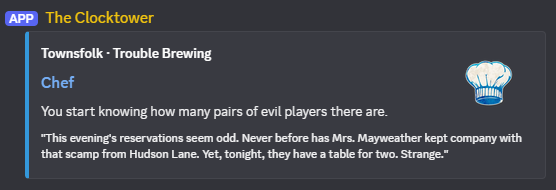

# A Discord bot for Blood on the Clocktower role information

In a server that includes this bot, sending a message like this:

```
[[Chef]]
```

will produce a reply with an embed like this:



You can also ask for multiple roles in the same message. By default it will provide results for the first three.

Data is sourced from https://botc-data.dixonary.co.uk which is itself a rehosting of data provided on GitHub from TPI at https://github.com/ThePandemoniumInstitute/botc-release.